# UAI Ledger

UAI Ledger executes AI requests and paid API calls, tracks costs, and manages credit wallets and queues. An application submits work to the service, receives a cost estimate, and follows the result through the API or TypeScript SDK. UAI maintains the financial journal, manages reservations, and records every provider attempt.

The service is designed for self-hosting. The primary deployment model is a separate installation per application, with its own PostgreSQL database, storage, configuration, and provider credentials.

This repository contains a working local implementation, an admin interface, and a test application. Full production readiness requires separate validation of infrastructure, settings, and individual connections. Validate each provider connection with your own credentials and spending limits before enabling user traffic.

## What it is for

When an application uses several models, making an HTTP call is only part of the job. It also needs to determine who pays, how much money is reserved, what happens after a network failure, and whether an operation can be retried safely.

UAI handles this server-side work:

- Maintains credit wallets, individual credit lots, expiration dates, reservations, charges, and refunds.
- Estimates costs using published versions of models and rates.
- Executes text, image, speech, embedding, and paid-tool requests through adapters.
- Manages queues, quotas, concurrency, timeouts, cancellation, and recovery after failures.
- Records attempts, provider costs, and customer settlement.
- Delivers events and results to the application and supports acknowledgment after persistence.
- Gives administrators access to wallets, operations, connections, budgets, and queue status.

User registration, product roles, the application interface, payment collection, subscriptions, taxes, and commercial discounts remain the responsibility of the application and its payment service. UAI provides server-side authorization and accounting mechanisms that can be integrated with them.

## Request lifecycle

1. The application selects a published model profile or recipe and supplies the input.
2. UAI returns a `quote` containing the payment terms, configuration versions, and required reservation.
3. Once the quote is accepted, the service reserves funds and creates an operation. Repeating the same idempotent command does not create another charge.
4. A worker obtains queue and quota admission, records dispatch intent, and calls the provider.
5. UAI persists the result and usage information, calculates the charge, and releases unused reservations according to the accepted operation's rules.
6. The application receives the result, persists it in its own storage, and acknowledges delivery. UAI removes temporary content according to its retention policy while keeping the required financial history.

For composite work, an application can open a reservation pool and create associated invocations as work progresses. See the [quoting and reservation rules](docs/QUOTING.md).

## Financial rules

Provider costs, customer credit charges, and external payment revenue are accounted for separately. A successful generation does not prove its exact cost is known, and a delivery error does not erase costs already incurred.

| Situation | UAI behavior |
|---|---|
| A client repeats a financial command | Returns the previous command's result when its idempotency key and data match |
| Funds are reserved | Preserves the accepted work's terms and configuration versions |
| A provider may have accepted a request, but the response was lost | Preserves the unknown outcome; does not treat the cost as zero or blindly repeat potentially completed work |
| Confirmed usage becomes available | Calculates the charge under the accepted policy, with protection against duplicate charging |
| The result is technically defective | Applies platform-funded payment rules and records the platform's costs |
| Rates change | New versions apply to new work; existing operations keep their accepted terms |

Profiles support several payment policies: a final price agreed before execution, actual-usage settlement within an accepted maximum, and the `estimated_actual` forecast mode. In forecast mode, the reservation is not a ceiling on the final charge; an authorized policy can allow debt. The client interface must respect the selected mode instead of presenting every forecast as a guaranteed price.

Integer monetary values are transmitted as strings in the API. Monetary budget units, credits, and provider-native allowance units are distinct. Their meaning and invariants are described in [accounting](docs/ACCOUNTING.md), [quoting](docs/QUOTING.md), and the [paid API contract](docs/PAID_API_CONTRACT.md).

## Architecture



One codebase is divided into processes with separate roles:

| Component | Purpose |
|---|---|
| API | Authorization, wallets, quotes, operation acceptance, result reads, and events |
| Workers | Request execution, adapter calls, result persistence, and attempt settlement |
| Scheduler | Recovery, financial deadlines, credit expiration, cleanup, and queue maintenance |
| PostgreSQL | Financial journal, configuration, operations, attempts, and consistent state |
| Redis / BullMQ | Distributed job delivery and execution coordination in the corresponding mode |
| Blob storage | Temporary input files and results, using the local filesystem or S3-compatible storage |
| Admin | Installation management through a server-backed administrative interface |
| Demo | A separate test client for checking the complete API and SDK workflow |

The backend is written in TypeScript and uses Fastify. The interfaces use TanStack Start, React, and shared UI components. API schemas and TypeScript SDK types are included in the repository.

Multiple execution nodes require shared storage and consistent installation configuration. Startup order, container templates, and their validation boundaries are documented in [deployment](docs/DEPLOYMENT.md).

## Providers and configuration

The code registers adapters for OpenAI, Anthropic, Cartesia, Serper, Firecrawl, Cerebras, Groq, Google Cloud, Quiver, Replicate, Voyage, and TypeSafe. Synthetic adapters are also available for local checks.

An adapter does not imply support for every model or operation a provider offers. Check the specific integration contract for supported capabilities, parameters, usage limitations, and validation status. Real prices and limits must also be verified before use.

Models, rates, routes, recipes, and API definitions live in [configurations/](configurations/). Changes are validated and published as immutable versions. These files contain no credentials. The admin interface displays file-owned definitions and exposes the supported operational settings.

See [file configuration](docs/FILE_CONFIGURATION.md), [universal invocations](docs/INVOCATIONS.md), and [deployment requirements](docs/DEPLOYMENT.md).

## Quick start

This workflow creates a new local test installation with synthetic models. It needs no provider credentials; real paid calls are disabled by default.

### Requirements

- Node.js 22.12 or newer.
- pnpm 9.15; the project version is pinned in `package.json`.
- Docker with Docker Compose for PostgreSQL 17 and Redis.
- Available local ports `55432`, `56379`, `4310`, `4311`, and `4312`.

### 1. Install dependencies and prepare data

```sh
git clone https://github.com/vleytman/uai-ledger.git
cd uai-ledger
pnpm install --frozen-lockfile
docker compose up -d --wait
cp .env.example .env
```

Load the environment variables from the repository root:

```sh
set -a
source .env
set +a

pnpm db:migrate
pnpm seed
```

`seed` is allowed only when `UAI_ENV=test`. It creates synthetic profiles, a zero-balance test account, and local interface configuration. Random passwords, service tokens, and the credential-vault key are written to the Git-ignored `.data/` directory.

The seed models and rates are behavioral fixtures. They do not represent actual provider prices or offerings.

### 2. Start the processes

Open five terminals. In each terminal, change to the repository root and run this environment setup block:

```sh
set -a
source .env
set +a

export UAI_DEMO_CONFIG="$PWD/.data/demo-config.json"
export UAI_ADMIN_CONFIG="$PWD/.data/admin-config.json"
export UAI_DEMO_ROOT="$PWD/.data/demo"
export UAI_BLOB_ROOT="$PWD/.data/blobs"
```

Then run one command in each terminal:

| Process | Command | Address |
|---|---|---|
| API | `pnpm dev:api` | `http://127.0.0.1:4310` |
| Worker | `pnpm dev:worker` | Background process |
| Scheduler | `pnpm dev:scheduler` | Background process |
| Admin | `pnpm dev:admin` | `http://127.0.0.1:4311` |
| Demo | `pnpm dev:demo` | `http://127.0.0.1:4312` |

Check basic API availability with:

```sh
curl http://127.0.0.1:4310/health
```

### 3. Test a request in the demo

Open the demo and sign in with `login_password` from `.data/demo-config.json`. The admin interface has its own password in `.data/admin-config.json`.

Grant test credits through the demo's designated form. Select a synthetic profile, request a quote, confirm execution, and check the result, reservation, and charge. The API, worker, and scheduler must be running for this workflow.

Detailed commands for BullMQ queues, S3, individual fixtures, and diagnostics are in the [local run guide](docs/LOCAL_RUN.md). Do not start a second process set against an installation already using the same ports and database.

## Application integration

Integration runs on the application's server. Provider keys and UAI service tokens stay on the backend. The application must validate its user session and permissions before submitting work to the service.

The TypeScript SDK lives in [packages/sdk/](packages/sdk/). It exposes wallets, quotes, operations, universal invocations, files, and events. Request schemas and server-side interaction examples are documented in the [API contract](docs/API.md). The local SDK workspace package should not be assumed to be a published npm package.

For external authentication and teams, use the [identity contract](docs/EXTERNAL_AUTH.md). For embedding administrative modules in your own shell, see the [modular admin contract](docs/MODULAR_ADMIN.md).

## Repository structure

| Directory | Contents |
|---|---|
| [apps/](apps/) | API, worker, scheduler, admin interface, and demo |
| [packages/](packages/) | Accounting, quoting, execution, queues, adapters, SDK, shared contracts, and UI |
| [configurations/](configurations/) | File-based model, route, rate, and API definitions |
| [migrations/](migrations/) | Versioned PostgreSQL migrations |
| [scripts/](scripts/) | Migrations, seed, schema generators, fixtures, and validation commands |
| [deploy/](deploy/) | Templates for deploying process roles separately |
| [templates/](templates/) | Product admin-shell integration template |
| [docs/](docs/) | Setup, integration, configuration, and operations guides |

## Validation

Main commands from the project root:

```sh
pnpm check:api
pnpm check:configuration
pnpm check:paid-api
pnpm typecheck
pnpm docs:check
pnpm build
```

For integration tests, load the environment for a separate test database and run:

```sh
REQUIRE_INTEGRATION_TESTS=1 pnpm test
```

Without `DATABASE_URL`, some PostgreSQL tests are skipped. Such a run does not establish financial invariants. The test role needs `CREATEDB` for isolated scenarios; never point tests at production or the active demo database.

Use the [local guide](docs/LOCAL_RUN.md) to start the services and run development checks. Markdown and JSON-example validation does not replace implementation tests, and passing fixtures does not establish real-provider behavior.

## Real requests and operations

Before using a paid provider, supply your own credentials, verified model parameters and rates, published configuration, budgets, and quotas. `UAI_ALLOW_REAL_PROVIDERS=false` blocks real calls by default. Financial report imports and external webhook delivery are enabled separately.

`.env`, `.data/`, keys, and local reports are excluded from Git. A working deployment needs separate secrets, backups of the database and encryption key, configured storage, and a tested recovery process.

The quick-start admin and demo are intended for local development. Before exposing them externally, validate authorization, network boundaries, and operational requirements against the [deployment guide](docs/DEPLOYMENT.md).

## Documentation

- [Service overview and boundaries](docs/README.md).
- [Architecture and module ownership](docs/ARCHITECTURE.md).
- [Credit lots, postings, and financial invariants](docs/ACCOUNTING.md).
- [Quoting, pricing, and reservations](docs/QUOTING.md).
- [Execution, cancellation, timeouts, and recovery](docs/EXECUTION.md).
- [API and SDK](docs/API.md).
- [Operations, budgets, quotas, and observability](docs/OPERATIONS.md).
- [Local run guide](docs/LOCAL_RUN.md) and [deployment](docs/DEPLOYMENT.md).
