# Accounting, credit lots, and reservations

[Contents](README.md)

## Three independent kinds of accounting

1. Usage records work performed by the provider. It exists even when the application fails.
2. Provider cost records our cost. The calculated amount and provider confirmation are distinct.
3. The wallet journal records users' budget entitlements and spending. A charge does not equal every provider expense.

Your external payment service records revenue and monetary refunds. A UAI wallet shows the customer's credit budget, not the money available in your OpenAI or other provider account.

## Credit unit

The first version adopts ai-credit-usd-v1:

~~~text
1 USD = 1 000 000 000 budget units
1 credit = 0.001 USD = 1 000 000 budget units
0.000001 credit = 1 budget unit
~~~

A budget unit is an integer number of nanodollars of accounted budget. PostgreSQL stores amounts as bigint; the API transmits decimal strings to avoid JavaScript Number precision loss. The UI displays credits with appropriate precision. Display rounding does not change the journal.

Users pay calculated cost at published applicable rates, including known discounts and caching. A late aggregated provider discount belongs to provider cost and future rates, rather than automatic recalculation of all wallets. Overcharging caused by our calculator is grounds for a mandatory audited compensating posting; it is not permissible margin.

Rates are stored as decimal numbers with a stated unit, such as USD per million tokens. Calculations use decimal arithmetic. Billable items retain the exact intermediate result. The attempt total is rounded to a budget unit once, using half-up; allocation across lots preserves the exact rounded total. Maximum reservations round upward.

The first launch may choose a different constant before any grants exist. Once credits have been issued, this credit unit's constant is immutable. A future different unit receives a new ID and separate wallet. Implicit conversion of existing lots is prohibited.

USD is the first version's settlement currency. For a provider using another currency, retain the original amount, currency, and approved FX snapshot. Without an exchange rate or upper bound on currency risk, that route cannot be admitted under a limited budget. Automated currency trading is outside the product.

## Grant lot

A credit lot contains:

- lot_id, wallet_id, credit_unit_id;
- original_amount_units and immutable budget_per_credit_units;
- grant_source: purchase, subscription, promotion, refund, migration, internal;
- external_reference and a unique grant source;
- terms_version and a terms snapshot, including expires_at;
- created_at and the actor authorizing the grant.

The lot's remainder is determined by postings. Original grant fields are not edited. Purchase price is unnecessary for executing requests and stays in the payment service. A purchase reference is needed for audit and revocation.

Example:

| Grant | Sold to user for | Credits | Fixed budget |
|---|---:|---:|---:|
| Lot A under old terms | $10 | 3 000 | $3 |
| Lot B under new terms | $10 | 2 000 | $2 |

The combined wallet contains 5 000 credits and $5 of budget. A retail price change does not change A. A provider rate card change affects new action quotes, rather than A's original budget.

Expiry is an explicit condition of every grant. The command must supply expires_at: a timestamp or explicit null for a non-expiring lot. For a subscription without rollover, the payment service supplies the end of the specific paid period. A new month creates a new lot and does not extend the old one. Expiry transfers unused amounts to expired rather than deleting history. An operator cannot retroactively shorten an issued lot's term by ordinarily editing a plan.

Reservation and balance reads check expires_at against server time even when the scheduler lags. Expired available credits cannot be spent before the background expire entry: the operation first materializes required postings in its own transaction. The plan, period calendar, and rollover permission remain with the payment service; the AI platform enforces lot terms.

## Reservations and charges

The diagram shows common postings within a credit lot. Capture and release can split one reservation: capture the charge and release the unused hold. Refunds follow lot validity rules and may create a replacement lot. Expiry, revocation and estimated-actual debt are described separately below and in [Quoting](QUOTING.md).

## Postings

Each journal transaction has a type, idempotency identity, actor, reason, and references to a grant, operation, request, or original transaction. Its postings balance within one credit unit: signed amounts sum to zero.

User lots use available, reserved, revocation_reserved, consumed, expired, and revoked states. Technical issuance and adjustment accounts maintain balanced postings. This is a journal of usage entitlements, not a revenue accounting ledger.

| Operation | From | To | Effect on available balance |
|---|---|---|---|
| grant | issuance | lot.available | Increases |
| reserve | lot.available | lot.reserved | Decreases |
| capture | lot.reserved | lot.consumed | Already reflected by reservation |
| release | lot.reserved | lot.available | Increases |
| expire | lot.available | lot.expired | Decreases |
| refund | lot.consumed | lot.available or refund lot | Increases |
| prepare revocation | lot.available | lot.revocation_reserved | Decreases |
| commit revocation | lot.revocation_reserved | lot.revoked | Already reflected by hold |
| cancel revocation | lot.revocation_reserved | lot.available or lot.expired | Restores availability if the lot is still valid |

History is append-only. An incorrect posting is corrected by a reversing or compensating transaction referencing it. Deleting history to correct a balance is prohibited.

Materialized balances are updated atomically with postings and the outbox event. For every wallet revision:

~~~text
balance_units = available_units + reserved_units
available_units >= 0
reserved_units >= 0
sum(postings.amount_units per journal transaction) = 0
~~~

Reserved_units in a wallet snapshot includes AI-operation reservations and revocation_reserved. API and UI may additionally show these two parts. A specific AI-operation sees only its own reservation and cannot use a purchase-refund hold.

Consumed is excluded from the current balance. Grant and refund history is needed for reconciliation but must not increase the calculated balance a second time.

The application summary (`GET /v1/admin/credit-summary`, [API](API.md#application-credit-summary)) is calculated without writing postings. Issuance comes from lots; consumed, refund, and revoked come from postings by journal transaction time. Expiry is attributed to the lot's `expires_at`: it includes `lot.expired` plus the available remainder of an already expired lot whose `expire` has not yet been written. Therefore reading `/lots` or another operation that materializes expiry does not change the summary. Reservations and revocation holds in an expired lot are shown separately until closed.

## Lot selection and concurrent reservations

UAI spends expiring lots first, ordered by expires_at, then created_at and lot_id. Non-expiring lots come last. This gives concurrent requests a deterministic allocation order.

Operation creation, reservation, and lot allocation occur in one transaction. Checking and reducing available is protected by a wallet lock or equivalent atomic scheme. An in-memory worker check is insufficient.

Reservation allocations record the lots supplying the amount. Capture debits these allocations; release returns to the same ones. Partial results and refunds retain their connection to original lots.

Lot expiry affects only the available remainder. An accepted reservation remains usable until the operation's final deadline. Releasing a reservation after expires_at sends the remainder to expired rather than extending the lot. Such amounts appear as released and expired, not as new available balance.

Refunding credits to a valid lot keeps that lot's terms. If the lot has expired, the refund creates a new lot with source refund and the original credit unit. The example compensation policy sets expires_at 30 days after the refund and retains the rules version; choose and fix that duration in grant terms before launch. This compensates a specific capture, rather than rolling over an unused monthly balance. The refund cannot exceed the amount spent and not yet refunded. Repeating the command grants nothing again.

## Reservation lifecycle

A quote alone locks no credits. Accepting it creates an operation and reserves max_units. Refreshing the browser or accepting again with the same key returns that same operation.

Each concurrent request claims a share of the operation's unused reservation. Captures plus open request budget claims must stay within the operation maximum. This prevents two workers from spending the same remaining credits.

In a reservation pool, each call's claim is created on admission. If the free reservation portion is insufficient, the shortfall is added from free credits to the same operation reservation. When `estimated_actual` spending exceeds the claim, the excess is covered first by the operation's free reservation portion, then free credits, then debt. A single operation has no free portion, so its behavior is unchanged. See [reservation for compound work](QUOTING.md#reservation-for-compound-work).

Each new attempt checks the user claim, available provider budget, and a separate platform loss limit. A technical retry that cannot be charged to the user still requires platform budget.

The customer reservation covers one successful delivery per billable unit, allowing for an authorized expensive fallback and no cache. It isn't multiplied by four or sixteen to cover failures that are free to the customer.

Before each attempt, UAI separately reserves its own defect/failure risk. It releases the confirmed portion covered by a customer capture, records defects, authorized subsidies, and free late delivery as platform-funded costs, and keeps exposure for any uncertain portion. A successful execution alone does not release this risk. Provider exposure can remain open after customer finances have closed.

Loss limits apply per request, recovery incident, and installation period. Concurrent workers consume them atomically. If any limit is exhausted, new attempts stop even when the attempt-count limit has not been reached.

After final request settlement, its chargeable cost is captured and its claim reduced. The unused portion may remain in the common operation reservation until other requests finish. The remainder is released when the operation completes.

| Step | Balance | Reserved | Available |
|---|---:|---:|---:|
| Granted | 1 000 | 0 | 1 000 |
| Reserve 180 | 1 000 | 180 | 820 |
| Capture 50 | 950 | 130 | 820 |
| Capture 70 | 880 | 60 | 820 |
| Release 60 | 880 | 0 | 880 |

Amounts here are in credits. All database operations use budget units.

## Usage and caching

A usage observation contains provider connection, attempt, provider event identity, raw payload reference, received time, provider time if available, and a final/cumulative/delta flag. A duplicate event does not increase spending. A cumulative counter replaces the previous estimate for its revision rather than being added to it.

A normalized billable item contains dimension, quantity, unit, and rating conditions. Example dimensions: input.uncached, input.cache_read, input.cache_write, output.text, output.image, audio.characters, audio.seconds, tool.search, compute.seconds.

Cache write additionally contains TTL. Modality, service tier, region, and context length are rate conditions when they affect provider pricing.

Adapters must keep billable categories separate. If the provider includes reasoning in output, retain it as an analytics breakdown without adding it to the bill twice. If cached input is included in total input, split it using that provider's documented semantics. There is no safe universal subtraction formula for every provider.

Reading an already paid result with the same request ID neither calls the provider again nor creates another capture. This is different from provider-side prompt caching. Cross-user caching of saved answers is outside the first version.

Usage is saved before domain validation of the answer and before optional result processing. A JSON-schema, image-download, or application failure must not erase known spending. If mandatory audit cannot be recorded before submission, the worker does not make a paid call.

## Price and confirmation level

A cost entry contains normalized usage, raw source, model, connection, provider rate version, priced_at, currency, exact decimal amount, rounded units, and cost state.

States: provisional, calculated, reported, reconciled, unknown. Reported means an amount returned by the provider for that call. Reconciled means confirmed at the available reconciliation level; a daily aggregate does not become an individual invoice for each request.

Missing usage, zero quantity, and an unsuccessful call are distinct. Zero is valid only for a confirmed zero billable quantity or documented free operation.

The user's accepted quote pins the operation's maximum permitted calculated rates. If the published applicable price falls before dispatch, customer rating uses the lower total for identical usage under the accepted and new versions. Provider cost reflects the latest known applicable provider rate. These amounts usually coincide. If the provider raises its price after quote acceptance, the difference is recorded separately and does not increase the agreed user maximum. QUOTING defines dispatch rules in this case.

A purchased lot does not freeze the provider rate card forever. It freezes only its budget amount. The user's next operation is quoted at current published rates.

## What the user pays for

Baseline actual_usage policy:

| Situation | Provider cost | Wallet charge |
|---|---|---|
| Successful request and available result | All attempts are retained | Chargeable usage of successful delivery |
| Invalid SVG, corrupt file, or violation of the specified structure | Defective attempt spending is retained | Zero for the defective attempt; repairs are also free until a valid result |
| Technical retry after a platform failure | All costs are retained | Platform pays for the failed attempt |
| Provider executed the request, but our failure prevented result delivery | Spending is retained | Pending for at most one hour; then release, or refund if already captured |
| User requests new generation | New request | New spending |
| Downloading a ready result again | No new AI call | No new charge |
| User cancels before submission | No spending | Release |
| User cancels after submission | Spending may occur | Confirmed work within the accepted policy and maximum |
| Partially completed image batch | Each attempt's spending | Ready delivered units; others are resolved separately |

The platform validates the result's technical contract before declaring ready. Conditions are defined before the call: JSON schema, image decodability, permitted SVG, and other registered technical checks. Validators do not execute arbitrary application code. Incompatible parameters and a known invalid schema are rejected before a paid call. Subjective quality judgments or domain validation unknown to the platform do not make a valid request free. A trusted application may request a separate audited refund.

v1 uses partial_policy=successful_parts: each valid available unit is charged even if the next action or another participant fails. Four images are four separately accounted units. If an adapter cannot reliably divide a common response's cost between successful and defective results, the batch is split into individual requests before submission. Invented proportional costs are prohibited. The all_or_nothing rule is deferred.

For technical SVG repair, only the valid final attempt is charged; the platform bears preceding defective attempts' costs. A valid SVG with an unsuitable composition is already billable, and another variation is new work. User cancellation after dispatch charges confirmed spending of the active attempt, including work before stopping, but does not transfer earlier defective attempts to the customer.

Capture for a valid ready result does not wait for application acknowledgement: the ability to retrieve content within the announced window is the delivered service. Acknowledgement controls deletion. If the application fails to save an available result before expiry, no free regeneration arises. A platform failure that makes the result unavailable requires recovery or compensation.

The platform does not promise zero losses of its own. They are bounded by max attempts, technical failure budget, protection against repeated unknown outcomes, and an overall organization spending limit.

## Unknown outcome

A network disconnect after possible submission creates an attempt with outcome_unknown. Known usage observations are retained. A rejection before work starts that the adapter marks nonbillable (`billable: false` for a credential, billing, or rate-limit rejection) creates no uncertainty: its cost is zero and the request closes immediately. Missing confirmation does not authorize new generation. The worker uses lookup or native idempotency only when supported by the provider.

An operation may have a completed user workflow and simultaneously be settlement_pending. Financial status is not inferred from execution status alone.

One hour is counted from the first unresolved_at. Repeated lookups, worker restarts, and new observations do not reset the timer. The rule covers both unknown chargeable usage and known spending when our failure prevents result delivery. After one hour, the scheduler creates an idempotent audited resolution: the disputed reservation portion is released, and an earlier incorrectly completed capture is compensated. Confirmed successful operation parts retain their charges. For an expired lot, release goes to expired; capture compensation follows the refund rule.

Closed amounts are not automatically charged later, including for user-cancelled operations. Possible cost remains in provider exposure and the platform loss journal at its previous uncertainty level. Wallet closure does not mean zero cost or confirmation that no invoice exists. A connection may be suspended at its uncertain-spending limit.

Closure moves an uncertain attempt to `abandoned`: it no longer occupies a limiter slot, while its cost remains unknown in exposure. When an operator confirms from provider data whether the call was billed, an audited resolution closes exposure with actual cost or zero; the user charge remains zero.

This is a deliberate customer-service policy. It does not prove the absence of a provider invoice. The unresolved exposure threshold and count of unknown operations per account limit repeatedly receiving service through such failures.

Timeout release does not authorize restarting the old attempt. Permitted metadata, usage, and hashes are retained for auditing a late response, without a permanent content copy. The result itself may be temporarily delivered without a new charge after financial closure only if no tombstone exists and content policy permits it. A late response does not restore a deleted project. New work requires a new operation or an explicitly authorized retry under EXECUTION.

## Refunds and purchase revocation

A refund references a capture and is bounded by its unrefunded amount. Repeating a command with the same key does not create a second compensation.

A monetary purchase refund requires revoking available credits of the original grant. The overall balance of an arbitrary lot cannot simply be reduced, nor can another operation's active reservation be taken.

Safe interaction with the payment service uses this procedure:

1. prepare revocation holds the available portion of the relevant grant and returns revocation_id and reconcile_after.
2. The payment service makes the monetary refund with its own idempotency.
3. commit revocation transfers the hold to revoked; cancel returns it to available.
4. reconcile_after triggers reconciliation/an incident, but never automatically releases the hold. After a payment-service crash, reconciliation is required to distinguish a refund not started from one already completed. Only confirmed commit or cancel ends the hold; cancel after lot expiry sends the amount to expired. The one-hour AI-spending rule does not apply to purchase revocation.

If credits are already insufficient, prepare returns conflict with the available amount. The payment service defines partial monetary refund, debt, or account-blocking policy. The first AI-wallet version does not automatically enter a negative balance.

To enforce the payment service's decision, the API provides separate spending suspend/resume. Suspend prohibits new operations and dispatch of requests not yet submitted, cancelling those requests with proper release. Already submitted attempts receive cancel where supported and normal settlement. Resume permits new work but does not resurrect cancelled jobs or remove a provider block.

## Financial invariants

- One source event creates at most one financial effect.
- Grant, reserve, capture, release, and refund preserve continuous history.
- User spending does not exceed the accepted operation maximum.
- Lot allocation equals the posting amount exactly.
- An operation cannot spend one reserve simultaneously through multiple claims.
- Unknown usage does not become zero provider cost.
- Deleting an application or project does not delete financial history.
- A provider invoice adjustment does not create a retroactive customer debit.
- A technical retry does not disappear from cost when the result is free to the customer.
- The API balance reflects committed transactions, not browser state.

## Paid API extension

See the [paid API contract](PAID_API_CONTRACT.md) for provider accounts, usage units, periods, allowance reservations and supported HTTP endpoints.
