# Execution, queue, and recovery

[Contents](README.md)

## Execution with a final price

With a `quoted_final` recipe, UAI uses the price and prepared attachments saved when the quote was accepted. A valid, available result charges that price exactly, whatever the actual provider cost. Cancellation without a result, technical defects, and results arriving after financial closure create no new charge. The cancellation and actual_usage rules below apply to legacy profiles; final-price mode follows this policy.

Each attempt separately records usage and provider cost, including technical retries and fallback. A successful attempt charges the customer price once; unsuccessful attempts remain platform expenses. Unknown cost is not replaced by zero. Route spending, retry, and platform risk limits apply independently of the customer price. Fallback must support the agreed parameters and file preparation. Changes to published rates do not change an accepted customer quote.

Calculation and validation details are in the [specification](MODEL_PRICING.md).

## Execution levels

An operation is a user action with a shared budget. A request is one logical request. An attempt is one attempt at a specific provider. A native provider job may outlive the HTTP connection and worker.

execution_status and settlement_status must be stored separately. Financial closure cannot be inferred solely from generation success.

~~~text
Operation execution:
accepted -> running -> completed | partial | failed | canceled | refused
                  -> paused -> running

Request execution:
queued -> leased -> submitting -> running -> succeeded
                  -> waiting_retry | waiting_recovery -> queued
                  -> outcome_unknown
                  -> failed | canceled | refused

Settlement:
open -> pending -> settled
                -> unresolved -> platform_absorbed | settled
~~~

An attempt does not become a new attempt by overwriting its row. A new attempt has the next number and separate provider IDs. Outcome_unknown remains available for resolution even after user-facing operation closure.

The complete command atomically sets admission_closed_at. New requests are then rejected, but existing ones continue. The operation becomes terminal after accepted work finishes; settlement may remain pending. Repeating an existing request key is allowed as a read of its prior result. Cancel closes admission and additionally requests cancellation. An operation cannot be closed, have its reservation released, and then accept a new request.

finish-partial closes admission and cancels requests not yet submitted, including paused/requote_required. Submitted requests continue to be observed and undergo normal settlement. It is needed when the application wants to retain ready parts and abandon remaining work; complete alone does not do this. Execution and financial closure have separate events.

After admission closes, while accepted work is still running, cancellation may be strengthened: complete → finish-partial → cancel. A reverse transition does not resume requests or change the closure reason. Repeating the same or a weaker command returns current state without another closure event or financial effects. After terminal execution_status, all closure commands preserve the outcome, reason, and closure time. This rule checks request completion, not settlement_status: financial closure alone does not end observation of an unknown outcome.

After accepted requests finish, the operation outcome reflects their results. Open admission retains accepted; explicit operation cancellation gives canceled. In other closed operations, successes mixed with failures or cancellations give partial; successes alone give completed. With no successes, any failure gives failed, while cancellation of all requests gives canceled. These rules are identical for the public API, operation list and details, and admin overview. Charges are determined by each request's settlement, separately from aggregate status.

## One request's path

1. Check authorization, accepted operation, component, input hash, and call-count limit.
2. Atomically create a request and its budget claim, or return the existing request by client_request_key.
3. Save the job in the durable queue. Publish queued through the outbox.
4. The scheduler selects a route considering limits, state, waiting time, and available budgets.
5. A worker acquires a lease with a fencing token, saves an attempt before possible submission, and records submission intent.
6. Make the external request, saving remote IDs and available intermediate usage observations.
7. Save final usage before result processing. Retrieve native results and files if needed.
8. Validate the technical result contract. Record result and settlement under ACCOUNTING.
9. In one transaction, save capture/release, the new wallet revision, and events.

If the worker cannot confirm a durable write before the external call, it does not send the call. If the post-call write fails, the attempt requires recovery rather than new generation.

## Queue

A job has priority, enqueued_at, not_before, deadline, lease_owner, lease_expires_at, and an attempt limit. The server assigns priority under application policy. The client cannot grant itself maximum priority.

The queue is served fairly across applications/accounts with concurrency limits. Older jobs gradually gain precedence so a continuous flow of new jobs cannot block them forever.

Rate-limit waiting does not occupy a generation work slot. The job receives not_before and returns to the available queue. The UI sees waiting_rate_limit, the expected next attempt time, and cancellation availability.

At queue deadline, a request not yet submitted is cancelled without provider cost and releases its budget share. A native job already accepted by a provider requires separate cancel/status and settlement.

initial_queue_budget_seconds bounds waiting before first submission. The overall deadline defaults to 300 seconds and includes queue, backoff, and execution. It runs from acceptance and is not extended by retries or polling. Expiry prohibits new submissions but does not end financial reconciliation of an already submitted attempt.

## Rate limits

The limiter key reflects the actual limit scope: provider organization, project, connection, model family, or shared quota group. Multiple API keys for one account do not automatically increase the limit.

Requests per interval, input/output token capacity under provider semantics, active jobs, and other documented constraints are accounted separately. Limit consumption does not always equal billable usage. It uses estimateLimitUsage rather than the monetary calculator.

A conservative demand estimate is applied before dispatch. After the response, the limit model is adjusted from headers and documented provider semantics. Cached tokens may affect cost and throughput differently.

Retry-After defines a minimum delay when it refers to a transient failure. Bounded exponential backoff and jitter are added. A missing header does not imply immediate retry. Retries are also bounded by deadline and max attempts.

429 insufficient quota, billing failure, and permanent permission errors are not handled as temporary rate limits. The connection receives the corresponding state and incident. Cause is determined from status and error code, not HTTP status alone.

## Connection states

| State | Permitted behavior |
|---|---|
| healthy | Normal routing |
| rate_limited | Defer until the next available interval |
| degraded | Limit concurrency; use permitted alternatives |
| circuit_open | No new requests until recovery is checked |
| recovery_wait | Shared pause until the next authorized recovery cycle |
| probing | Only the probe lease owner checks recovery; others wait |
| locked | Cycles exhausted; new paid calls prohibited until manual enable |
| budget_exhausted | Wait for external top-up or select another permitted connection |
| auth_failed | Credentials must be corrected |
| disabled | No submission until explicitly enabled |
| balance_stale | Apply a conservative risk limit; do not claim an exact balance |

Models on one connection may have different health. An image endpoint failure need not disable text. A shared financial block covers the entire relevant provider account.

Recovery checks use a documented free endpoint where suitable. A paid probe generation is not started implicitly. A separate policy may authorize it with platform budget.

Free reports and checks may continue after locked, but a successful response does not remove the block. An administrator fixes the cause and explicitly enables the affected scope with a reason. Enable does not resume terminal user requests; they require a new operation. Acknowledging an incident is not enable. budget_exhausted/auth_failed have no automatic paid-probe cycle.

## Failure classification

| Failure | Retry or failover |
|---|---|
| Confirmed transient rejection before execution | Allowed within policy and budget |
| Temporary rate limit | Retry after delay or use an authorized alternative |
| Exhausted quota/funds | Disable the route until state changes; an authorized alternative is possible |
| Invalid credentials | Correction required; automatic retry of the same connection does not help |
| Invalid parameters/unsupported capability | Return an error; do not try providers at random |
| 5xx without proof of non-execution | Treat outcome as potentially uncertain |
| Timeout after possible submission | Lookup or documented idempotency, otherwise outcome_unknown; explicit `timeout_retry` permits retry with risk of a second provider charge |
| Technical result validation failure | Preserve provider cost at platform expense; within the accepted overall policy |

HTTP 5xx alone does not prove that work did not execute. The adapter classifier may mark an error safe_to_retry only based on the specific endpoint's contract.

The attempt counter increases on each new dispatch, including a confirmed rejection or 429. Local limiter waiting, polling the same native job, and documented recovery of the same external idempotent operation do not create new generation. Those checks have separate budget and network limits. Outcome_unknown interrupts the automatic cycle regardless of remaining attempts.

## Overall attempt limit

An accepted request stores resolved `execution` and the published file-policy ID. The default allows 300 seconds from acceptance and four submissions including the first. The installation operational limit is eight and is rechecked before dispatch. Worker restart, model change, schema defect, and job redelivery do not reset the attempt number.

The first two permitted submissions select primary; later ones use an explicitly configured fallback or the same primary if no fallback exists. An authorization failure or exhausted quota may immediately switch to an authorized different connection. Invalid input, cancellation, model refusal, and unknown outcome do not authorize new generation.

`backoff` specifies base_ms, multiplier, cap_ms, and jitter_ratio. Default delays without jitter are 1, 2, and 4 seconds. Retry-After is a lower bound. If the next submission would fall at or after the deadline, it is not scheduled. `recovery.delays_seconds` defaults to empty; an explicit finite list increases the delays of those same attempts without creating additional cycles.

A technical defect after preliminary output permits retry only with `retry_after_output=true`. When an attempt changes, clear its preliminary output. Treat streamed fragments as provisional until a complete result has been validated; see [streaming and delivery](INVOCATIONS.md#streaming-and-delivery).

`refused` is terminal without fallback. With `billing.refused=platform`, the customer charge is zero; `actual_usage` applies the accepted calculation. Unknown cost remains subject to financial reconciliation. Disabling retries does not disable original-job lookup or one-hour financial closure.

## Failover

RouteVersion contains ordered alternatives, required capabilities, region/data-processing constraints, maximum cost, attempt count, and switching conditions. A user requirement for a specific model prohibits substitution with another model.

Selecting an alternative rechecks input schema, context limit, image input, structured output, tools, streaming, parameters, cache assumptions, and budget. Unsupported parameters cannot be silently removed or result quality changed.

Loss of cache during switching is included in the reservation. A new provider connection may price the same model differently. The actual target is saved in the attempt and returned in result metadata.

Once an answer stream has been shown to the user, automatically continuing with another model's text is prohibited. An alternative may create an explicitly new draft after clearing the previous one with a clear event, only if the application supports this scenario and policy permits it. By default, the stream stops with an available status.

Outcome_unknown does not authorize automatic failover. Explicit retry after uncertainty requires separate confirmation of double external spending risk and new authorized budget. It references the original request but is new work. Personal Codex mode retains the absence of automatic switching to a paid API.

## Native async jobs

If a provider returns a job ID, it is saved before waiting for the result. The scheduler polls with backoff and an overall limit. Provider webhooks are signature-verified and linked to a known job; duplicates and event order are handled safely.

GET of a result does not trigger regeneration. Unknown provider status is not replaced with guessed success. Cancel remains a cancellation request until the provider confirms a terminal state. Usage and cost for a cancelled job may still arrive later.

## Cancellation

Before submission, cancellation completes a request without provider cost. After submission, the platform calls available cancel and stops launching new child requests. Active sibling requests are accounted independently.

Closing a tab or losing the SSE connection doesn't stop the worker. To cancel work, use the cancellation API. The user can reconnect later, read the operation, and retrieve results that are ready.

After dispatch, cancellation charges confirmed spending of the active attempt within the accepted maximum. Earlier defective attempts remain platform expenses. Pending cancel does not guarantee a stop at the provider. If usage or delivery outcome is unknown, ACCOUNTING's one-hour financial closure applies; cancellation does not reset its timer.

## Lease and recovery

The diagram covers lease expiry. Resumed work still needs valid deadlines, quotas, and budgets. Attempt timeouts and policies that explicitly accept duplicate provider cost follow the separate rules below.

A worker periodically renews its lease. A fencing token prevents an old worker from committing a result over a new owner's result. It cannot itself prevent a second external call.

After lease expiry:

- If submission is known not to have begun, the job may return to the queue.
- With a remote job ID, the next worker resumes observation of the same job.
- If the endpoint guarantees idempotency, a retry uses the same external key and payload.
- If execution is possible but cannot be checked, outcome_unknown is set.

A worker can fail after recording submission intent but before making the call. That still leaves uncertainty: without a provider contract that lets UAI check or safely repeat the call, it cannot know which side of submission the failure occurred on. Exactly-once execution at an external provider cannot be guaranteed.

`attempt_timeout_seconds` limits a single attempt. Whichever comes first, that timeout or the request deadline, ends the wait. For synchronous HTTP, cancellation closes the connection; a native job continues to be observed under the existing rules. UAI records `timed_out_at`, leaves cost unknown, and resolves it through reconciliation.

A retry is allowed when the adapter declares idempotency: a new attempt on the same connection and model reuses the previous key (`AdapterContext.idempotency_key`). Policy can also permit `timeout_retry: "accept_duplicate_cost"`, explicitly accepting the risk of a second provider charge within the platform risk budget. Otherwise, the request becomes outcome_unknown immediately after timeout. If output has already been displayed, `retry_after_output` also applies.

An uncertain attempt holds a limiter concurrency slot while its outcome may still arrive: until request financial closure and no later than deadline plus 5 minutes for a synchronous call or plus the polling window (1 hour) for a remote job. Financial closure moves that attempt to `abandoned` in the same transaction. A late response is still recorded for reconciliation. An operator may resolve the outcome through a command with a reason and audit; see [operations](OPERATIONS.md#limiter-slots-and-unknown-outcomes).

## Events and result delivery

Durable events have event_id, sequence, occurred_at, scope, and resource refs. SSE resumes with Last-Event-ID. If an old cursor is unavailable, the client reads a snapshot and starts from the current sequence.

Text deltas are presentation data and are not stored in the durable financial outbox. Losing them must not affect the wallet. The final result is available through the request resource until acknowledgement/expiry/deletion. The resource then retains metadata and the reason content is absent; GET does not trigger generation. Financial events come from the committed outbox and contain wallet revision. Delivering an event with a result reference does not extend content TTL.

The committed domain transaction creates the charge; events report it. Receiving an SSE event or repeated webhook never justifies another capture.

## Distributed admission binding checks

Before creating submission intent, `assertQuotaProof` compares the full set of current-route groups against the issued admission or bundle. During the transaction, membership is protected by a shared advisory lock on the connection/model pair; the binding-write trigger uses a matching exclusive lock. The lock also covers adding a missing row, but not independent models. Reading membership takes no tuple lock, avoiding a wait for UPDATE/DELETE already waiting on that advisory lock. After the transaction, provider submission runs without SQL locks.

Changing capacity does not revoke a previously issued valid admission. Checks remain for request/fence, admission age, heartbeat, protective hold, absence of release/unknown, and full group membership. Changed bindings require new admission; using only part of an old bundle is prohibited.

## Native webhook HTTP entry

The API forwards the original signed body to receiveNativeWebhook through a separate parser that does not change normal JSON routes. Scope is derived from the stored request. The adapter verifies the signature and links the event to the active attempt's remote_job_id before recording usage. Shared observation lease, quota feedback, and settlement then apply; an already recorded event_id creates no duplicate effect. Redis feedback for BullMQ is persisted through the existing quota_result_feedback journal; an application failure leaves the entry for maintenance replay.

The body is limited to 1 MiB; duplicate headers are rejected. HTTP 503 preserves the need for redelivery; the HTTP entry does not replace polling or claim that webhook content is saved before signature verification. Supporting a specific native provider requires verifyNativeWebhook and a callback URL in submitNative; current verification uses a synthetic native adapter. See the [HTTP contract](API.md#incoming-provider-webhooks).

## BullMQ transport and admission preparation

A BullMQ worker executes a specific request with persisted backend/generation/purpose. Stale delivery and a retry after settlement do not create a new attempt. Deferred repeat work is scheduled by the PostgreSQL scheduler; the queue does not receive an independent provider retry policy. Native observation and maintenance have separate queues and limits.

A large quota window may require several preparatory Redis commands. Each pass processes no more than 4096 events; intermediate results do not authorize submission. Usage changes, history restoration, and event expiry invalidate corresponding derived data. Only the final check of every rule creates a quota permit. After 20 seconds, unfinished preparation returns not_ready, leaving intent for safe continuation. Details and operational constraints are in [operations](OPERATIONS.md#provider-quota-group-settings).

## Paid API extension

See the [paid API contract](PAID_API_CONTRACT.md) for provider accounts, usage units, periods, allowance reservations and supported HTTP endpoints.

## Priorities and SVG

See [model capabilities](MODEL_CAPABILITIES.md) for embeddings, structured responses, SVG support, limits and example configurations. Publish compatible profiles and configure connection budgets before making real calls.
