# External Authentication

[Contents](README.md) · [Modular Admin](MODULAR_ADMIN.md)

Your backend authenticates users and checks their team memberships. It then passes the verified identity to UAI, which applies its own account and token restrictions. Keep users, sessions, teams, and memberships in your application. You can use Better Auth there, but UAI doesn't depend on it.

## Setup



This is the successful user-context path. Your backend checks the session, membership, and product permissions; UAI checks its service token and account scope. Staff access to the shared admin build uses the separate adapter described below.

1. Apply migrations, including `0055_external_identity.sql`, before starting the updated API. Verify the upgrade using a separate database, rather than the active demo.
2. Give the server key the required existing scopes and the additional `identity:assert`. Old keys do not receive it automatically. A user key must not have credit-grant or installation-management permissions.
3. Check `await client.assertExternalIdentitySupport()`. `/health` must return `capabilities.external_identity: 1`. An old or unavailable API is not considered compatible. An external administrative build performs this check itself.
4. In the parent backend, verify the session, current membership in the selected team, and product permissions for the action/project.
5. Obtain the server-side team binding to a UAI account/wallet and create a separate SDK client with the current request's context.

```ts
import {UaiClient} from '@uai/sdk';

const service = new UaiClient({baseUrl: apiUrl, token: serverToken});
await service.assertExternalIdentitySupport();

// These values come from server-side session and membership verification.
const client = service.forIdentity({
  version: 1,
  kind: 'user',
  user_id: verifiedUser.id,
  account_id: verifiedTeam.uaiAccountId,
});
const wallet = await client.wallets.get(verifiedTeam.uaiWalletId);
```

`forIdentity` creates a separate client with an immutable copy of the context. Requests from different teams or tabs therefore cannot switch each other's identity. The SDK sends that context with ordinary calls, uploads, downloads, and SSE. Transport retries keep the same body, idempotency key, and identity.

Trusted server code with `accounts:write` performs provisioning: `accounts.create` receives the stable team ID as `external_account_id` and `create_wallet`. The `application_id + external_account_id` pair is unique; repeated and concurrent creation returns the existing account. Email is not part of any key. A user with membership in two teams uses two bindings while retaining one external user ID.

## Context Format and Trust

The `x-uai-context` header contains `encodeURIComponent(JSON.stringify(identity))`, up to 4096 characters. The schema is strict; unknown fields, version, role, empty/control IDs, and duplicate headers are rejected. The SDK builds the header itself.

The user form contains `version: 1`, `kind: user`, `user_id`, and `account_id`. The administrative form contains `version: 1`, `kind: staff`, `user_id`, and `role: admin | viewer`. Parent permissions and cookies are not included in the context.

Organization/application come from the service token. A user's account further constrains the token's permitted scope and must exist within it. User context cannot execute administrative or financial grant/refund commands even if the original key has broad permissions. Staff context likewise cannot gain scopes absent from the token.

Create this assertion on the backend after checking the session and permissions. Never forward a browser-supplied identity header or expose the service token to the browser. Use HTTPS. UAI trusts a backend with `identity:assert`; it does not validate Better Auth cookies or look up memberships in that system.

Ordinary service-only integrations remain supported. A compromised server key remains privileged access; the supplied identity does not protect against that key's owner.

## Shared Administrative Build

```ts
import {createAdminBackend, SessionError} from '@uai/admin-module/server';

export const handle = createAdminBackend({
  loadConfig: loadServerConfig,
  auth: {
    mode: 'external',
    publicOrigin: 'https://admin.example.test',
    loginUrl: '/sign-in',
    adapter: {
      async authenticate(request) {
        const user = await parentAuth.requireCurrentUser(request);
        const role = await parentAuth.getStaffRole(user.id);
        // An authenticated person without a staff role must receive 403
        // through the adapter's SessionError, rather than a team role.
        if (!role) throw new SessionError(403, 'Staff access required');
        return {version: 1, kind: 'staff', user_id: user.id, role};
      },
      async logout(request) {
        return parentAuth.logoutResponse(request);
      },
    },
  },
});
```

Supply your application's own `parentAuth` and `loadServerConfig`. Returning `null` from the adapter produces 401. For an authenticated person without staff access, throw the server entrypoint's `SessionError` with status 403. Other identity-source failures produce 503. UAI rejects invalid identity shapes and user identities in this admin adapter. An error never falls back to password login.

Server config contains `api_url`, `admin_token`, `account_id`, and `wallet_id`. The last two fields preserve compatibility with default wallet addresses; they are not staff identity and grant no permissions. External mode does not need `session_secret` or `login_password`. Without `auth`, or with `mode: standalone`, the existing owner login using those secrets is preserved.

The adapter checks the session and role on every request. Logout forwards your application's response, including cleared cookies, and the login URL must belong to the configured origin. Changes, including logout, still require a matching Origin and JSON; external login keeps CSRF checks in place. After 401/403, the UI rechecks the session. The server denies the action regardless of what the button shows.

`admin` has standard administrative actions within service scopes. `viewer` receives only reads from an explicit registry. Changes, generations, retry, cancellation, and POST calculators are unavailable. Navigation, filters, and details remain available. The API repeats role checking on direct calls. Viewing model/rate/route configurations preserves the existing requirement for `config:write` on the service key, but does not grant viewer permission to make changes.

Product handlers default to admin-only. Safe viewer reads require explicit `permissions.reads`, for example `{'app.product.settings': ['admin', 'viewer']}`. POST commands are forbidden to viewer even if the role was mistakenly included in permissions.commands. Handler context contains safe `identity` and `role`; it does not receive the service token. The product validates data and implements idempotency, resource authorization, and audit itself.

Operation details for viewer use explicit safe projections. User parameters, response schemas, prompts, files, and raw provider responses do not become accessible through admin-viewing permission. The host generator creates `external-auth.example.ts` with an unimplemented adapter that denies access until the parent is connected.

## Audit and Financial History

The new nullable `audit_identity` column stores version, organization/application, service principal ID, external user ID, account ID, external team ID, and operation ID when present. Team ID comes from the verified account. Historical `actor_id` is not redefined; old entries retain an unknown human identity. Email and session data are not recorded.

Attribution for operation snapshots, quotes, requests, and financial entries is created in the transaction and is immutable. A subsequent action by another employee receives its own audit. Successful external HTTP commands are additionally recorded atomically with their result; an idempotent replay preserves the first author. Request bodies and secrets are excluded from the HTTP command log.

A background action has an unknown human and a link to its originating operation. The original user/team snapshot remains on the operation instead of being replaced with the last active user. `getOperation` and the financial ledger return the corresponding attribution.

Team switching, email changes, membership deletion, and late results do not change the payer of accepted work. A refund refers to the original charge and wallet. Already accepted tasks continue under accepted terms after their initiator is removed. The parent forbids new actions by a removed member.

## Streams and Access Revocation

Send browser streams through your backend. Check membership before forwarding subsequent events and periodically while the stream is idle. If access is revoked, close the stream and cancel the SDK subscription. UAI cannot see your membership changes. It separately rechecks the service token, `ai:read`, and account restrictions on open SSE connections, closing them if that access is narrowed.

Project, round, researcher, approval, and additional-permission control is outside UAI. After approval, the parent sends an ordinary authorized command.

## Local Verification

`UAI_ENV=test DATABASE_URL=<test PostgreSQL with CREATEDB> pnpm exec tsx scripts/run-external-auth-fixture.ts` starts a synthetic parent host on loopback `http://127.0.0.1:4327`, creating a separate database through the test helper. Real providers are disabled. The created database is deleted on shutdown. Do not use fixture sessions as a production-login example.

The host contains two teams, a user in both, a user in one team, a team administrator without a staff role, and viewer/admin employees. Control actions allow removing membership, downgrading a role, and revoking a session. Verification results distinguish confirmed scenarios from integration boundaries.
