# File configuration

[Contents](README.md) · [Local Run](LOCAL_RUN.md)

Keep model definitions, pricing, routes, recipes, and API services in Git. Keep connections, secrets, and operational limits in the installation database. The commands below connect the two without putting credentials in the repository.

## Data Ownership

| Source | Data |
|---|---|
| JSON in Git | Profile identifiers, parameters, calculation components, markup, safety factor, pricing examples, rates, route and recipe definitions. |
| TypeScript | Versioned adapters, provider authentication, HTTP protocol, usage and error normalization. |
| Operational database | Connections and secrets, budgets, quotas, notifications, installation bindings, active publication. |

Example: [openai-nano.json](../configurations/ai/openai-nano.json). Adapt the model parameters, rates and bindings for your installation; recheck provider prices and model availability before publication.

The [JSON Schema](../configurations/schema.json) defines the file format, resource kinds, fields, and references. UAI's domain validators also check calculation methods, rates, and recipes. Run `pnpm check:configuration` to check that the schema is current, or `pnpm generate:configuration` after changing the format. These files configure the existing calculation engine; they cannot add executable code, arbitrary HTTP endpoints, secrets, or new workflows.

Use `@rate_card:key`, `@catalog:key`, and `@route:key` for references within a bundle. Use `@connection:primary` and `@budget:period` for installation bindings. The publisher resolves these only in designated fields; it leaves user text and formulas alone.

Example of a separate installation binding file, which must not be added to Git:

```json
{
  "connections": {"primary": "conn_example"},
  "budgets": {"period": "provider-month"}
}
```

The binding file contains identifiers, not API keys. Its connection must belong to the same installation and match the model's provider. When UAI accepts work, it checks funds, credentials, and enabled status through the usual admission rules. Publishing configuration does not create or reconfigure those operational resources.

## Validation, Publication, and Activation



Publishing saves an immutable release; activation makes it selectable for new quotes. Neither step changes the versions already saved on accepted work. The diagram groups validation and preview together because both roll back their checks.

First apply migrations to the selected local database with `pnpm db:migrate`. The commands below read `DATABASE_URL` from the environment; replace `org_example` and `app_example` with existing identifiers.

```sh
pnpm configuration validate --file configurations/ai/openai-nano.json --bindings .data/bindings.json --organization org_example --application app_example
pnpm configuration preview --file configurations/ai/openai-nano.json --bindings .data/bindings.json --organization org_example --application app_example
pnpm configuration publish --file configurations/ai/openai-nano.json --bindings .data/bindings.json --organization org_example --application app_example --actor owner
pnpm configuration status --organization org_example --application app_example
pnpm configuration activate --release release_example --revision 0 --organization org_example --application app_example --actor owner
```

Both `validate` and `preview` need the target database. They run the publication checks inside a savepoint, then roll everything back. Preview also shows changed paths, values, and bindings compared with the latest publication. Neither command activates a version or calls a provider.

`publish` saves the whole bundle in one transaction. UAI hashes the normalized content and bindings together, so publishing the same bundle again, even concurrently, returns the existing release. Changing a binding creates a new version. References resolve to immutable database version IDs.

Commit the file before publishing. UAI rejects a dirty working tree by default; use `--allow-dirty` only when you intentionally need a local verification run. The file must be inside the current Git repository, even after resolving symlinks.

Publication history records Git HEAD, whether the file differs from HEAD, the SHA-256 of the bytes read, relative path, schema version, publisher, release, and dependencies. Publishing identical content again keeps the first publication's provenance.

Publishing makes a release available; `activate` switches the whole bundle into use. Start with `--revision 0` if nothing has been activated, then use the revision returned by `status`. UAI rejects a stale revision, and repeating the same command is safe. To roll back, reactivate an older release with the current revision. Each switch has its own history record.

Administrators can inspect inactive versions, but clients cannot discover them or select them for new quotes, even by supplying a recipe number. Existing quotes and accepted operations keep their saved references, parameters, formula, and adapter version. Editing a Git file alone changes no running work.

Provider cost uses the currently active rate; customer charging preserves the existing comparison policy against the accepted rate. Stored markup comes from the accepted operation. A new inactive publication does not change the current rate. This preserves the separation between provider cost and customer charge, including existing `outcome_unknown` rules.

The TS adapter registry contains the existing `openai@1`, `anthropic@1`, `cartesia@1`, and `serper@1`. A file model specifies its version explicitly; the quote carries it into the stored route, and runtime selects the implementation by that version. An unknown version is not automatically replaced with another. Adapter behavior changes must receive a new version; the old implementation is retained while unfinished work references it. This mechanism does not prevent arbitrary code replacement under the same ID.

## Administrative Interface

On Models, Pricing, Routes, and Recipes pages, file records are marked `Git · Active` or `Git · Inactive`. An active old version remains visible when a new one is published. The card provides source, Git revision, hash, author, dependencies, and the standard visual representation of the model, calculation, rates, or recipe.

Edit file-managed definitions in Git. The UI cannot rename them or create new versions, and older HTTP paths return `file_managed_configuration`. SQL triggers protect both the source and its published records; using a new version number does not bypass ownership. You can still try different inputs in the read-only calculator without changing the definition or calling the model.

Connections, budgets, quotas, and notifications remain operational settings. Publication does not overwrite them. Use the CLI to activate releases; the admin interface does not provide a publication editor.

## Migrating Existing Profiles

`configuration export --file <repo-file.json> --bindings <local-bindings.json> --baseline <local-baseline.json> --bundle <key> --organization <id> --application <id>` reads definitions without changing the database. Output files are created only if files with those names do not already exist. `scripts/export-local-configuration.ts` is a limited wrapper for the local demo; it does not read credentials.

`configuration adopt --file <repo-file.json> --bindings <local-bindings.json> --baseline <local-baseline.json> --reason <reason> --organization <id> --application <id> --actor <id>` checks IDs/hashes of the latest legacy versions, transfers keys to a single file owner, and publishes a release in one transaction. A changed baseline requires another export. Activation uses the separate `activate` command; publication does not change operational limits or credentials. Original versions are preserved. After adoption, they cannot be edited or renamed through legacy API/SQL. Returning to DB-managed editing is not supported; rolling back an operational profile requires publication/activation of a verified file definition.

## Universal Execution Policies

The execution_policy resource stores the complete execution schema. Example: [default](../configurations/execution/default.json). It uses the same validate/preview/publish/activate path; a separate policy bundle does not require a recipe. An active policy with key=default sets the application default. A route may reference execution_policy_version_id through the @execution_policy:key symbol inside the bundle and partially override execution. Accepted requests store the final terms and version ID. Operational max_attempts and max_deadline_seconds live in invocation_execution_limits, rather than an independent file policy editor.

## Additional model examples

See [model capabilities](MODEL_CAPABILITIES.md) for embeddings, structured responses, SVG support, limits and example configurations. Publish compatible profiles and configure connection budgets before making real calls.

## GPT-6 Luna

A separate [openai-luna6.json](../configurations/ai/openai-luna6.json) bundle adds `gpt-6-luna` with reasoning, Standard rates, caching, and actual charging. Profile parameters and limits are defined in this JSON file.
