# Universal Invocation Integration

Use the SDK to submit work, follow its progress, and save the result. The [API](API.md), [execution](EXECUTION.md), and [quoting](QUOTING.md) references cover the full contracts. Local example prices are synthetic. Check a model's published `text_features` to see what it supports; the provider name alone isn't enough.

## Application Server

Keep the UAI token on your application server. The browser calls your backend, which creates a `UaiClient` with `baseUrl` and `token`, checks `/health`, and uses `forIdentity` to pass an identity it has verified. Check permissions before accepting any account, project, or identity from the browser. See [external authentication](EXTERNAL_AUTH.md).

Give each invocation a persistent idempotency key and save it with the accepted `request_id`. If the network fails, repeat the call with exactly the same bytes and key, or reconnect to the accepted request. A new key starts new work and can create a new charge.

```ts
const result = await client.ai.run({
  account_id: accountId,
  profile: 'configured-text-profile',
  input: {
    messages: [{role: 'user', content: [
      {type: 'text', text: 'Describe the image.'},
      {type: 'image', asset_id: inputAssetId},
      {type: 'text', text: 'Keep the answer brief.'}
    ]}]
  },
  parameters: {max_output_tokens: 512},
  execution: {max_attempts: 4},
  billing: {refused: 'platform'}
}, {
  key: savedInvocationKey,
  onAccepted: async accepted => saveRequestId(accepted.request_id),
  onAttempt: async () => clearProvisionalOutput(),
  onDelta: async delta => appendProvisionalOutput(delta.text),
  persist: async snapshot => saveResultDurably(snapshot)
});
```

Choose the profile, parameters, and budget limit from your published configuration; the example above does not configure a model for you. With `estimated_actual`, UAI reserves the estimate, but the final charge can differ and may create debt after a cache miss. Use `isInsufficientCredits(error)` to offer a top-up without starting another invocation.

## Request and delivery flow



This is the successful quote-based path, with UAI execution roles grouped into one participant. Your application must save the final result before acknowledging delivery. Streaming, reconnects and explicit cancellation follow the rules below.

## Streaming and Delivery

`ai.stream(body, {key, signal})` returns `accepted`, `attempt`, `delta`, and `result` events. Each delta identifies its request, attempt, generation, sequence, and optional `field_path`. The SDK drops duplicates and deltas from outdated attempts. Clear provisional output when an `attempt` event arrives. If you see `live_incomplete`, some of the stream was missed; use the final object as the authoritative result.

`delivery.field_paths`, for example `['/reply']`, streams selected JSON string fields as they arrive. These fragments remain provisional until the full schema is validated. With tools, exactly one call is validated; UAI returns the name and arguments, while the application decides whether to execute the tool.

Closing the stream or aborting it stops viewing, not execution. Call `requests.cancel(requestId, key)` when you want to stop the work. To reconnect, use `ai.resumeStream(requestId)`; it does not dispatch another provider call. Old deltas are not saved as financial events, so recovery may have a gap or return only the final result.

With `ai.run`, the SDK calls `persist` before sending ACK. If saving fails, it sends no ACK. With low-level `ai.stream`, save the result yourself, then call `requests.acknowledge` with the `result_version` and `manifest_hash` from `delivery`. After ACK, UAI may delete its temporary copy. Display the copy your application saved.

`execution_status` describes the work outcome; `settlement_status` describes whether financial settlement is complete. A `refused` outcome is not retried. By default, the platform bears refusal usage; the application may explicitly select `actual_usage`. Unknown provider usage does not become zero. `usage.attempts` exposes individual models and costs; `usage.summary.scope='all_attempts'` includes all attempts.

## Images and Wallet

`assets.upload` uploads the source file with SHA-256, type, and size. The order of image blocks determines image placement within the message. Preserve keeps the original bytes; transformation must be explicitly enabled in configuration. Images not used in blocks are rejected by the real text adapter.

Accepting a request that uses an input file extends its retention and holds it while the request is active. Reading a result or sending ACK neither extends retention nor deletes shared input. Use `assets.renew(id, key)` when you need more time. Once a file has expired or been deleted, upload your own original again; `reupload` works only while the old content is still available. Keep the permanent media library in your application.

`wallets.subscribe(walletId, {signal})` delivers an initial snapshot, followed by changes with increasing `revision`; after a disconnect it rereads the snapshot. `available_units` already excludes reservations. The application stores integer monetary values as strings, applies only newer revisions, and separately displays `reserved_units` and negative available balances.

## Embeddings

The `embeddings.generate` capability uses the shared `ai.run`/`ai.stream`, but does not deliver provisional vectors. Input is `input: {texts: ['first line', 'second line']}`; the `dimensions` parameter is optional. OpenAI `text-embedding-3-small`, `text-embedding-3-large`, and Voyage `voyage-4` are registered; local implementation does not establish live availability.

The profile publishes an `input_mode: 'embedding_batch'` calculation, without image assets. OpenAI uses `cl100k_base`; Voyage uses a conservative UTF-8 bound. An accepted batch is one work item and one reservation. Output contains `model`, `revision: null`, `dimensions`, and `data`; ordering is normalized by index. Details and reasons for the unknown revision are in the [model capabilities guide](MODEL_CAPABILITIES.md).

Shared limits: 128 strings, 16384 coordinates, and a 512 KiB result; dimensions and token limits are model-specific. Large allows 3072; Voyage allows 256/512/1024/2048 and query/document without truncation. See the [model and limit table](MODEL_CAPABILITIES.md). Missing or duplicate indices, wrong dimensions, and nonnumeric coordinates mean the entire batch is defective. The application stores vectors permanently after persist-before-ACK.

The protocol was checked against the [official embeddings API](https://developers.openai.com/api/reference/resources/embeddings/methods/create) on 2026-09-25. Synthetic test tariffs are not OpenAI prices.

## Additional model capabilities

The [model capabilities guide](MODEL_CAPABILITIES.md) describes optional/null JSON Schema and local refs, forced tool choice emulation, `priority`, `ai.forecast`, Recraft Styles/Vectorize, and Quiver. Forecasts do not reserve funds; new Quiver profiles have a cap without overdraft.
