# Operations and troubleshooting

[Documentation](README.md) · [API reference](API.md) · [Execution rules](EXECUTION.md) · [Deployment](DEPLOYMENT.md)

Use the admin interface to set up an installation and investigate requests, balances, and execution problems. As you work, keep provider costs, customer charges, provider-native allowances, and payment revenue separate. Each tells you something different.

## Configure a provider connection

1. Add the connection and its provider account scope in the admin interface.
2. Save the required credentials on the server. A generation credential and a reporting credential may have different permissions; configure them separately.
3. Verify model capabilities, account-specific rate limits and applicable rates before publishing a route.
4. Set provider and period budgets, quota groups and concurrency limits.
5. Publish and activate compatible definitions through [file configuration](FILE_CONFIGURATION.md).
6. Enable real requests only after checking the spending limits for this installation.

Open a connection to inspect its provider account scope, models, capabilities, credential status, health, quota groups, balances or spending limits, data freshness, and pending exposure. You can check the credential's status without seeing its secret. Adding another key for the same provider account gives you neither another balance nor another quota.

Disable a connection when investigating authentication or financial problems. A free health check does not automatically authorize generation or clear a financial block. A paid probe is itself a potentially billable request and needs a configured budget.

## Budgets and wallet funds

A funded wallet means the customer has credits. You still need funds and quota at the provider. Provider budgets limit your exposure there; a separate platform-loss budget pays for permitted defective attempts and technical retries.

The `execution-budgets` administrative resource changes budgets used by workers. Monetary values are integer strings in internal USD units: 1 USD = 1 000 000 000 units. A provider budget belongs to a connection; a period budget belongs to a recipe key. Lowering a limit does not erase spending or open exposure. Further work is rejected when it no longer fits.

Budget edits require a reason, an idempotency key and the expected previous limit. Changing a connection's `risk_policy` alone does not update its execution budget. Application-scoped administrators cannot change a shared budget key used by several applications.

Wallet views distinguish total balance, available funds and reservations. Inspect individual lots for their original budget, remaining funds, expiration and external grant reference. Administrative grants and compensation require permission and a reason; arbitrary production balance editing is not a substitute for ledger commands.

For pricing modes that permit overdraft, inspect debt separately from prepaid lots. The initial reservation must still be funded. See [accounting](ACCOUNTING.md) and [quoting](QUOTING.md).

## Provider balance snapshot

A provider balance snapshot records its source, account scope, native unit or currency, observed time, coverage and precision. A manual spending cap is not a provider-reported balance. A successful HTTP health check is not a financial snapshot.

If you don't know which usage a snapshot covers, you cannot claim an exact available balance. Conservative availability subtracts usage after the covered period and accounts for unfinished requests. Label stale or incomplete observations clearly. Never turn them into zero or use them to increase availability.

A provider account may be shared by several keys or external applications. Its total balance cannot be assigned to an individual UAI wallet. When the provider does not expose a supported balance API, use explicit installation budgets instead of a fabricated balance.

Paid API subscriptions use their own counters, periods and rollover rules. See [provider allowance](PAID_API_CONTRACT.md) for snapshot constraints and overage handling.

## Reconciliation

Use reconciliation to compare UAI's recorded provider costs with an authoritative external report. Customer charging can already be complete when final usage supports the calculation; reconciliation is a separate check.

Check the following before accepting a comparison:

- The report covers the correct provider account, currency, period and dimensions.
- All pages were imported, and the coverage time is known.
- Reporting lag and incomplete buckets are accounted for.
- External spending not represented by UAI requests is classified as unattributed.
- Subscription-fee allocation does not count the same cost twice.

Corrections create additional financial records; they do not rewrite immutable history or silently create new customer debits. Missing reporting permissions, unsupported endpoints and incomplete coverage remain visible limitations.

`UAI_ALLOW_REPORTING_API` controls network report import separately from generation. Do not enable reporting solely because an inference key works.

## Provider quota group settings

Put connections and models in a common quota group when they share a provider limit. Multiple keys for the same account need the appropriate shared group. Check whether aliases share a quota pool rather than guessing from similar numbers.

Each group can define several rules, with a metric, time window and capacity, plus concurrency and interactive reserve. The `provider_capacity` represents the confirmed provider limit; a lower local capacity can keep operational headroom. Model price markup does not change provider quota.

Use the group editor to change supported limits. Settings and rule-set revisions are distinct: send the appropriate expected revision when using the API. Changes require audit and must not reset already consumed usage.

- `GET /v1/admin/provider-quotas/{id}/snapshot` reads local availability adjusted for provider observations without granting admission.
- `PATCH /v1/admin/provider-quotas/{id}/rules` changes capacities on existing rules without resetting usage.
- `PUT /v1/admin/provider-quotas/{id}/rules` replaces the rule set subject to the active-work and recovery constraints in the API contract.

The availability view distinguishes used, reserved, remaining and currently available quantities. Provider observations can further constrain availability. Old observations and expired windows must not be presented as current capacity. The interface refreshes the selected group and marks retained data stale after refresh errors.

Do not delete quota keys manually in a running Redis namespace. A partial reset can invalidate coordination assumptions. Redis access must support the required Lua operations and `INFO`; verify managed-service restrictions before using the distributed quota backend.

A large quota history may take several preparation passes. The request stays queued until preparation and durable confirmation finish. A delay in preparation never authorizes a provider call.

## Queue and concurrency settings

Queue, application and account limits control publication and active execution separately. Configure both when controlling backlog and concurrency. A BullMQ job count is not the same as the number of active provider calls.

Application admission limits can reject new work before customer funds are reserved. Defaults include 20 queued tasks per account, 200 per application and a 15-minute oldest-task threshold. An idempotent replay of already accepted work still returns that work.

The default request policy allows 300 seconds and four attempts including the first; the installation ceiling is eight attempts. Accepted requests retain their resolved policy. Do not treat retries, provider switching or long recovery as independent unlimited counters. See [execution](EXECUTION.md) for refusal, unknown-outcome and cancellation rules.

`priority: interactive` requests can use reserved capacity, but do not bypass budgets, account limits, provider rate windows or deadlines. A reserve does not preempt running work or guarantee latency. With total capacity 1, there is no physically separate interactive slot.

## Limiter slots and unknown outcomes

An `outcome_unknown` attempt can retain a protective slot while the provider may still be running. This prevents new work from treating an uncertain call as completed capacity.

For the legacy limiter, a synchronous attempt is bounded by the request deadline plus a five-minute grace period; native jobs use the remote-observation window of one hour after deadline. Financial closure can release the protective hold. BullMQ quota admission uses the group's `slot_expires_at` policy.

When unresolved work closes as `platform_absorbed`, its attempt becomes `abandoned` while the request remains `outcome_unknown`. A late response must not create a late automatic customer charge. Audited resolution requires evidence and preserves the financial record.

Releasing local capacity does not cancel a provider request. It also does not authorize a duplicate submission. See the [unknown-outcome rules](EXECUTION.md).

## Inspect an operation

Use this as an investigation map rather than a database schema. Every attempt can have usage and cost records, including failed attempts; only one branch is expanded here. Compare those records with the customer wallet journal instead of assuming the amounts must match.

Start with the operation, then follow its requests, attempts, usage, provider costs, and wallet postings. Check the accepted profile versions, actual model, timing, retry or failover reason, final usage, and settlement status.

Check customer reservations, provider exposure, and platform-funded costs separately. Execution may be finished while settlement is still unresolved. A missing charge does not make an unknown cost zero.

You can read prompts and results only with the required permission and while they are retained. After acknowledgment or expiry, metadata and checksums may remain even though the content is gone. That is expected; it doesn't mean the journal is corrupt or that you should generate the result again.

Before retrying, establish what happened. Rereading a saved result, retrying work known never to have been dispatched, and starting another paid attempt are different actions. A generic retry button cannot safely resolve an uncertain provider outcome.

## Metrics and queue diagnosis

Use domain metrics alongside infrastructure monitoring:

| Signal | Interpretation |
|---|---|
| Queue age and ready-to-first-dispatch delay | May include quota and concurrency waiting, not only platform overhead |
| Publication or outbox lag | Durable work is waiting for delivery; compare due times and the current dispatch generation |
| Worker heartbeat | Distinguishes running, draining and stale workers; does not prove a specific provider call succeeded |
| `rate_limit_starved` / `admission_timeout` | Admission could not obtain capacity under the request's limits |
| `settlement_errors` | Financial completion failed and needs investigation; do not manually mark the request paid |
| Unresolved provider exposure | Cost or outcome still lacks authoritative confirmation |
| Reconciliation freshness | Shows the coverage and age of external financial evidence |
| HTTP status observations | Separate provider failures from request-level final outcomes |

Percentiles without samples are unknown, not zero. Active leases may include native-job observers and are not a count of billable submissions. Historical observations do not replace live PostgreSQL, Redis, S3 and provider monitoring.

Logs should include correlation, operation, request and attempt IDs without credentials or full content. Logs are not the authoritative source of wallet balances.

## Incidents and notifications

Use incident state, affected routes, cooldowns and reasons to decide the next action. Correct the underlying cause before manually enabling a locked connection. Acknowledging an incident is not the same as enabling work.

`UAI_ENABLE_WEBHOOK_DELIVERY` controls external delivery. Webhook receivers must verify signatures, timestamps and event IDs, deduplicate and acknowledge after durable processing. Repeated delivery must not repeat a financial command. Keep notification recipients and destination configuration outside public fixtures.

## PostgreSQL connection budget by process

Every API, worker, and scheduler process has its own connection pool. Add the limits across all replicas when sizing PostgreSQL, and leave room for migrations and administration.

Set `UAI_DB_POOL_MAX_API`, `UAI_DB_POOL_MAX_WORKER` and `UAI_DB_POOL_MAX_SCHEDULER` for their roles. `UAI_DB_CONNECT_TIMEOUT_MS` and `UAI_DB_IDLE_TIMEOUT_MS` bound connection acquisition and idle retention. Do not increase replicas without considering the aggregate PostgreSQL connection budget.

Quota preparation that uses session advisory locks requires a direct connection or session pooling. Transaction pooling does not preserve session-lock ownership.

## Shared file storage

A local blob directory is suitable when all processes use the same filesystem. Separate execution hosts require a common S3-compatible backend and the same installation prefix. Configure access credentials privately and preserve the storage policy required by BlobStore.

The application remains responsible for permanent result storage. Back up PostgreSQL, the credential encryption key and retained blob content consistently. S3 alone does not reconstruct the financial or deletion journal.

## Shutdown, updates and recovery

Allow workers to drain on SIGTERM. `UAI_WORKER_SHUTDOWN_GRACE_MS` controls the grace period; forced shutdown may leave an unknown provider outcome. Stop an old process before starting its replacement against the same local resources.

During restore, apply the deletion journal and retention guard before serving content. A backup cannot restore a deletion record that was never included in it. Do not revive expired or deleted content merely because a blob reappeared in storage.

Follow [deployment](DEPLOYMENT.md) for migration order, shared storage, backups and restore drills. Check the API, database, Redis and storage separately: `/health` only confirms a live HTTP process.
